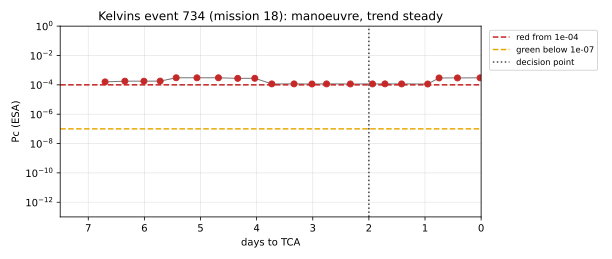

# keepout

Spacecraft conjunction assessment in Python: screening against the public
catalog, CCSDS CDM ingest and generation, probability of collision (Pc),
risk trends, a synthetic operator on public data, a command line and
collision-avoidance manoeuvre planning.

> **Status:** pre-alpha (milestone M7 — manoeuvre planning).

Pc algorithms are implemented from the published literature and validated
against the public test cases of the
[NASA CARA Analysis Tools](https://github.com/nasa/CARA_Analysis_Tools).
keepout is not affiliated with NASA; CARA files are downloaded on demand and
never redistributed.

## Validation

Every Pc method against every applicable CARA reference case
([full report](docs/validation.md)):

<!-- validation-summary:start -->
| Suite | Method | Cases passed | Worst relative error |
|---|---|---|---|
| Alfano (2009) | foster | 11 / 11 | 8.9e-08 |
| Alfano (2009) | elrod | 11 / 11 | 8.9e-08 |
| Alfano (2009), 3-D | hall3d | 12 / 12 | 5.5e-04 |
| CARA Pc method test set | foster | 53 / 53 | 2.7e-08 |
| CARA Pc method test set | elrod | 53 / 53 | 2.7e-08 |
| CARA Pc method test set, 3-D | hall3d | 53 / 53 | 2.1e-03 |
| CARA unit tests | foster | 3 / 3 | 3.7e-08 |
| CARA unit tests | elrod | 3 / 3 | 3.7e-08 |
| CARA unit tests | hall3d | 2 / 2 | 7.1e-04 |
| CARA unit tests, maximum Pc | frisbee | 2 / 2 | - |
| CARA unit tests, maximum Pc | dilution | 4 / 4 | 1.0e-03 |
<!-- validation-summary:end -->

Monte Carlo against CARA's two-body Monte Carlo
([full report](docs/validation-monte-carlo.md), checked nightly):

<!-- validation-monte-carlo-summary:start -->
| Suite | Method | Cases passed | Worst relative error |
|---|---|---|---|
| Alfano (2009), Monte Carlo | montecarlo | 12 / 12 | 7.3e-02 |
| CARA Pc method test set, Monte Carlo | montecarlo | 21 / 21 | 1.6e-01 |
<!-- validation-monte-carlo-summary:end -->

<!-- screening-socrates-summary:start -->
Close approaches from `screen` against CelesTrak's SOCRATES, on the 1275 SOCRATES approaches computed from the same element sets ([report](docs/screening-socrates.md)):

| Approaches | Compared | Within tolerance | Worst TCA | Worst range |
|---|---|---|---|---|
| fast (>= 1 km/s) | 266 | 261 | 0.493 ms | 0.49565 m |
| slow (< 1 km/s) | 1008 | 1008 | 324.653 ms | 0.49998 m |

5 approaches outside tolerance involve 2 objects whose element sets evidently differ from SOCRATES's. keepout also reports 5 minima of these pairs that SOCRATES does not list.
<!-- screening-socrates-summary:end -->

## Reading a CDM

```python
import keepout.cdm
from keepout import Conjunction

cdm = keepout.cdm.load("event.cdm")  # KVN or XML, CDM 1.0 or 2.0
primary, secondary = cdm.object_states()  # GCRF, SI units
plane = Conjunction(primary, secondary, combined_hard_body_radius=20.0).plane
print(plane.miss_distance, plane.covariance, primary.covariance.repairs)
```

## Probability of collision

```python
from keepout import compute_pc

conjunction = cdm.conjunction(combined_hard_body_radius=20.0)
result = compute_pc(conjunction)  # picks Foster, Hall 3D-Nc or a maximum Pc
print(result.method, result.value, result.diagnostics)
print(compute_pc(conjunction, "hall3d").details["nc"])  # a method by name
mc = compute_pc(conjunction, "montecarlo", samples=100_000, seed=1)
print(mc.value, mc.interval)  # with its 99% confidence interval
```

## Risk of an event

```python
from pathlib import Path

import keepout.cdm
from keepout import ConjunctionEvent, assess

cdms = [keepout.cdm.load(path) for path in Path("event").glob("*.cdm")]
event = ConjunctionEvent.from_cdms(cdms)  # one encounter, oldest CDM first
assessment = assess(event.observations(combined_hard_body_radius=20.0))
print(assessment.decision.action.name, assessment.decision.reasons)
print(assessment.trend.direction, assessment.level)
```

<!-- risk-kelvins-summary:start -->
keepout's decision for each of the 15321 events of ESA's Kelvins data, from ESA's Pc of every CDM ([report](docs/risk-kelvins.md)):

| Decision | Events | Share |
|---|---|---|
| ignore | 13823 | 90.2% |
| monitor | 1468 | 9.6% |
| prepare manoeuvre | 6 | <0.1% |
| manoeuvre | 24 | 0.2% |


<!-- risk-kelvins-summary:end -->

Kelvins data: ESA, *Collision Avoidance Challenge dataset*, Zenodo, 2021,
[doi:10.5281/zenodo.4463683](https://doi.org/10.5281/zenodo.4463683); © ESA,
[CC BY 4.0](https://creativecommons.org/licenses/by/4.0/).

## Screening

```python
from collections import Counter

from astropy.time import Time

from keepout import screen
from keepout.sources.celestrak import fetch_catalog

catalog = fetch_catalog()  # CelesTrak's public catalog, cached for two hours
iss = [omm for omm in catalog.omms if omm.catalog_number == 25544]
result = screen(iss, catalog.omms, Time.now())  # the next 7 days, a 5 km sphere
for approach in result.approaches:
    print(
        approach.tca.isot, approach.secondary_number, f"{approach.range_at_tca:.0f} m"
    )
print(Counter(skipped.reason.value for skipped in result.skipped))  # sets left out
```

Each approach holds both objects' GCRF states at TCA, the range at TCA, the
miss vector in the primary's RTN frame and the relative velocity. Screening
GP element sets finds geometry, not risk: they have no covariance and are
kilometres off within days. [Screening](docs/screening.md) explains the
method, the screening volumes (5 km as SOCRATES by default, NASA's 10 km for
GP data, the USSPACECOM Spaceflight Safety Handbook's by orbit regime), the
limits of GP data and the gap between the public and the full catalog; the
comparison with SOCRATES is under [Validation](#validation).

GP data: USSPACECOM/18 SDS via Space-Track.org, retrieved from CelesTrak
(celestrak.org); the frozen copy in `tests/screening/data/` was retrieved
on 2026-10-06, the frozen full catalog in `tests/screening/spacetrack-data/`
from Space-Track.org on 2026-10-15; neither is covered by keepout's MIT
licence (see their `NOTICE` files).

### Performance

The target: 20 primaries against the public catalog, and against the full
catalog, for a week in under 60 s with 4 worker processes. CI also times each
change against its merge base and fails on a slowdown of more than 20 %.

<!-- screening-benchmark-summary:start -->
Screening 20 LEO primaries against the 19914 element sets of the frozen public catalog (CelesTrak, retrieved 2026-10-06) for 7 days from 2026-10-06 00:00 UTC, with 4 worker processes (`tools/screening_benchmark.py`):

| Volume | Screened | Left out | Approaches | Wall time | CPU time |
|---|---|---|---|---|---|
| 5 km sphere (default) | 19886 | 28 stale | 715 | 8.5 s | 40.3 s |
| 10 km sphere (NASA, GP data) | 19886 | 28 stale | 2551 | 9.5 s | 44.3 s |
| SFS Handbook Table 3 | 19886 | 28 stale | 345 | 14.8 s | 65.2 s |

Times: median of 3 runs on 2026-10-07, Intel(R) Core(TM) i5-14600K (20 logical CPUs), Python 3.13.7; `--check` checks the counts, not the times.
<!-- screening-benchmark-summary:end -->

On the full catalog, which adds most of the rocket bodies and debris the
public catalog lacks (retrieved nine days later, so the week differs):

<!-- screening-benchmark-spacetrack-summary:start -->
Screening 20 LEO primaries against the 31930 element sets of the frozen full catalog (Space-Track, retrieved 2026-10-15) for 7 days from 2026-10-15 00:00 UTC, with 4 worker processes (`tools/screening_benchmark.py --source spacetrack`):

| Volume | Screened | Left out | Approaches | Wall time | CPU time |
|---|---|---|---|---|---|
| 5 km sphere (default) | 31914 | 5 future epoch, 11 propagation failed | 866 | 13.1 s | 56.1 s |
| 10 km sphere (NASA, GP data) | 31914 | 5 future epoch, 11 propagation failed | 2689 | 14.2 s | 59.3 s |
| SFS Handbook Table 3 | 31914 | 5 future epoch, 11 propagation failed | 787 | 20.1 s | 83.9 s |

Times: median of 3 runs on 2026-10-16, Intel(R) Core(TM) i5-14600K (20 logical CPUs), Python 3.13.7; `--check` checks the counts, not the times.
<!-- screening-benchmark-spacetrack-summary:end -->

## Synthetic operator and command line

```bash
pip install "keepout[cli]"
keepout screen --fleet examples/synthetic-operator/fleet.toml \
    --catalog tests/screening/data/celestrak-public.csv.gz \
    --start 2026-10-06 --days 7 --cdm-dir cdms
keepout assess cdms/*.kvn   # exit status 3 if an event needs a manoeuvre
```

`keepout screen` plays a conjunction assessment service for a fleet of real
satellites (here, in a clone of the repository, the ISS, Metop-B and
Intelsat 39 against the public catalog frozen on 2026-10-06): it screens
them, issues a CCSDS CDM for every close approach, computes the Pc from each
CDM and assesses each event (12 approaches that week, 2 to monitor;
[report](docs/synthetic-operator.md)). GP data has no covariance, so the
CDMs carry keepout's model of GP element-set errors, an explicit
[assumption](docs/assumptions.md) from the literature, not orbit
determination: the Pc values show what the model implies, not the
satellites' real risk. `keepout fetch catalog` downloads the live catalog,
from CelesTrak (no account) or Space-Track.org (the full catalog, with an
account, within its published limits); `keepout fetch cdm` lists
Space-Track's public CDM summaries; `keepout validate` checks keepout's Pc
against CARA's cases. See [Synthetic operator](docs/synthetic.md), [Command
line](docs/cli.md) and [Space-Track data](docs/spacetrack.md).

## Manoeuvre planning

```bash
keepout maneuver cdms/44476_55841_*.kvn --target-pc 1e-7 \
    --catalog tests/screening/data/celestrak-public.csv.gz
```

`keepout maneuver` takes the CDMs of one event and plans an impulsive burn
of the primary along its velocity: from the latest CDM it computes the Pc
of a grid of burns (signed Δv by burn time, from 2 days, or the CDM's
creation, to 6 hours before TCA), finds the smallest burn each way that
meets the target Pc (by default 1e-5, one order of magnitude below the red
threshold 1e-4, as a margin) and, given a catalog,
screens each burn against it for 7 days for the approaches it brings or
brings closer. Here, after the `keepout screen` example above, it plans
the yellow Intelsat 39 event: the prograde burn clears it at its TCA but
the re-screen finds the same pair back twelve hours later above the
target, so only the retrograde burn is clean. Exit status 4 means no burn
on the grid meets the target, the burn given with `--burn-before` and
`--dv` misses it, or every burn brings an approach at red or the event's
own pair back above the target. The covariances stay as the CDM
gives them, and the Pc of an approach the re-screen finds rests on assumed
covariances. See [Manoeuvre planning](docs/maneuver.md) for the method and
[Assumptions](docs/assumptions.md#manoeuvre-planning) for what it leaves
out.

<!-- maneuver-report-summary:start -->
The burns of METOP-B (38771) that clear a red event, CARA test CDM `000038771_conj_000030802_20201216_182131_20201215_171306` (2020 test data; HBR 10 m, CARA's value; [report](docs/maneuver-report.md)):


| Burn | Before TCA | Δv | Pc | Range at TCA | Method |
|---|---|---|---|---|---|
| none | - | - | 1.56e-03 | 148 m | foster |
| retrograde | 22.6 h | -0.00200 m/s | 7.87e-06 | 624 m | foster |
| prograde | 21.6 h | +0.00398 m/s | 6.43e-06 | 793 m | foster |

The plan of the 5642 cells took 12.3 to 16.2 s (CPU time 181.1 to 245.4 s, numerical libraries on their default threads) over 3 runs on 2026-11-03, Intel(R) Core(TM) i5-14600K (20 logical CPUs), Python 3.13.7; `--check` checks the numbers, not the times.
<!-- maneuver-report-summary:end -->

The full default grid, on a LEO event 48 h before TCA (12 896 cells), took
29.9 to 31.2 s with the numerical libraries on one thread and 33.4 to
46.1 s on their default threads (3 runs each, 2026-11-03, same CPU).

CARA test CDM: NASA CARA Analysis Tools (NASA Open Source Agreement),
downloaded on demand; only numbers derived from it and the figure are
committed.

## Development

```bash
uv sync
uv run pre-commit install     # every CI lint check, run on commit
uv run pytest                 # offline test suite
uv run pytest -m validation   # slow checks; downloads CARA and Kelvins data
uv run python tools/validation_report.py   # regenerate the validation report
uv run python tools/validation_report.py --monte-carlo   # Monte Carlo (slow)
uv run python tools/risk_report.py   # Kelvins risk report (downloads 221 MB once)
uv run python tools/screening_report.py   # SOCRATES screening report (offline)
uv run python tools/screening_benchmark.py   # screening benchmark (offline, minutes)
uv run python tools/screening_benchmark.py --source spacetrack   # on the full catalog
uv run python tools/synthetic_operator_report.py   # synthetic operator report (offline)
uv run python tools/maneuver_report.py   # manoeuvre report (downloads one CARA CDM)
uv run python tools/spacetrack_snapshot.py verify   # frozen Space-Track catalog (offline)
uv run ruff check && uv run ruff format --check
uv run mypy && uv run basedpyright
```

## Licence

MIT. The third-party data committed for tests is not covered: the CelesTrak
data in `tests/screening/data/`, the Space-Track data in
`tests/screening/spacetrack-data/` (see their `NOTICE` files) and the Kelvins
excerpt in `tests/sources/data/` (see its `README.md`).
