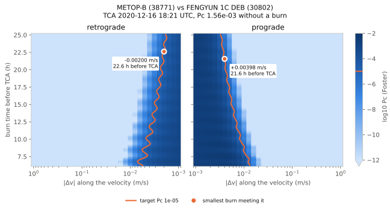

# keepout

Spacecraft conjunction assessment in Python: screening against the public
catalog, CCSDS CDM ingest and generation, probability of collision (Pc),
risk trends, a synthetic operator on public data, a command line and
collision-avoidance manoeuvre planning.

> **Status:** pre-alpha; the API may change without notice.

**Documentation: <https://kyrtap1309.github.io/keepout/>**

Pc algorithms are implemented from the published literature and validated
against the public test cases of the
[NASA CARA Analysis Tools](https://github.com/nasa/CARA_Analysis_Tools).
keepout is not affiliated with NASA. CARA files are downloaded on demand and
never redistributed.

## Install

keepout needs Python 3.11 or later. It is not on PyPI yet, so install it
from GitHub:

```bash
pip install "keepout[cli,store] @ git+https://github.com/Kyrtap1309/keepout"
```

The `cli` extra adds the `keepout` command and the `store` extra the
conjunction store (a SQLite file); the library needs neither. To run the
examples that read files committed to the repository, clone it instead:

```bash
git clone https://github.com/Kyrtap1309/keepout
cd keepout
uv sync --extra cli --extra store
```

## Example

```python
import keepout.cdm
from keepout import compute_pc

# A sample CDM in the repository; any CDM 1.0 or 2.0, KVN or XML, works.
cdm = keepout.cdm.load("tests/cdm/data/tracss_v2.kvn")
conjunction = cdm.conjunction(combined_hard_body_radius=20.0)  # [m]
result = compute_pc(conjunction)  # picks Foster, Hall 3D-Nc or a maximum Pc
print(result.method, result.value)  # hall3d 0.045044354503398956
```

New to conjunction assessment? [Concepts](https://kyrtap1309.github.io/keepout/concepts/) explains
the workflow and the terms (Pc, TCA, HBR, CDM, ...).

## Documentation

The documentation is published at <https://kyrtap1309.github.io/keepout/>:

- [Getting started](https://kyrtap1309.github.io/keepout/): install, where to start and a tour of every
  feature; [Concepts](https://kyrtap1309.github.io/keepout/concepts/) and the glossary.
- [Screening](https://kyrtap1309.github.io/keepout/screening/) and the
  [synthetic operator](https://kyrtap1309.github.io/keepout/synthetic/), with its
  [assumed covariances](https://kyrtap1309.github.io/keepout/assumptions/).
- [2-D probability of collision](https://kyrtap1309.github.io/keepout/pc-2d/) and
  [3-D, Monte Carlo and maximum Pc](https://kyrtap1309.github.io/keepout/pc-3d/).
- [Risk assessment](https://kyrtap1309.github.io/keepout/risk/) and
  [manoeuvre planning](https://kyrtap1309.github.io/keepout/maneuver/).
- [Command line](https://kyrtap1309.github.io/keepout/cli/), [the conjunction store](https://kyrtap1309.github.io/keepout/store/) and
  [Space-Track data](https://kyrtap1309.github.io/keepout/spacetrack/).
- [API reference](https://kyrtap1309.github.io/keepout/reference/), [FAQ](https://kyrtap1309.github.io/keepout/faq/) and
  [changelog](https://kyrtap1309.github.io/keepout/changelog/).

The same pages are in [`docs/`](docs/); `uv run mkdocs serve` renders them
locally.

## Validation

Every Pc method against every applicable CARA reference case
([full report](docs/validation.md)):

<!-- validation-summary:start -->
| Suite | Method | Cases passed | Worst relative error |
|---|---|---|---|
| Alfano (2009) | foster | 11 / 11 | 8.9e-08 |
| Alfano (2009) | elrod | 11 / 11 | 8.9e-08 |
| Alfano (2009), 3-D | hall3d | 12 / 12 | 5.5e-04 |
| CARA Pc method test set | foster | 53 / 53 | 2.7e-08 |
| CARA Pc method test set | elrod | 53 / 53 | 2.7e-08 |
| CARA Pc method test set, 3-D | hall3d | 53 / 53 | 2.1e-03 |
| CARA unit tests | foster | 3 / 3 | 3.7e-08 |
| CARA unit tests | elrod | 3 / 3 | 3.7e-08 |
| CARA unit tests | hall3d | 2 / 2 | 7.1e-04 |
| CARA unit tests, maximum Pc | frisbee | 2 / 2 | - |
| CARA unit tests, maximum Pc | dilution | 4 / 4 | 1.0e-03 |
<!-- validation-summary:end -->

Monte Carlo against CARA's two-body Monte Carlo
([full report](docs/validation-monte-carlo.md), checked nightly):

<!-- validation-monte-carlo-summary:start -->
| Suite | Method | Cases passed | Worst relative error |
|---|---|---|---|
| Alfano (2009), Monte Carlo | montecarlo | 12 / 12 | 2.5e-02 |
| CARA Pc method test set, Monte Carlo | montecarlo | 21 / 21 | 9.5e-02 |
<!-- validation-monte-carlo-summary:end -->

<!-- screening-socrates-summary:start -->
Close approaches from `screen` against CelesTrak's SOCRATES, on the 1275 SOCRATES approaches computed from the same element sets ([report](docs/screening-socrates.md)):

| Approaches | Compared | Within tolerance | Worst TCA | Worst range |
|---|---|---|---|---|
| fast (>= 1 km/s) | 266 | 261 | 0.493 ms | 0.49565 m |
| slow (< 1 km/s) | 1008 | 1008 | 324.653 ms | 0.49998 m |

5 approaches outside tolerance involve 2 objects whose element sets evidently differ from SOCRATES's. keepout also reports 5 minima of these pairs that SOCRATES does not list.
<!-- screening-socrates-summary:end -->

## Risk on real events

<!-- risk-kelvins-summary:start -->
keepout's decision for each of the 15321 events of ESA's Kelvins data, from ESA's Pc of every CDM ([report](docs/risk-kelvins.md)):

| Decision | Events | Share |
|---|---|---|
| ignore | 13823 | 90.2% |
| monitor | 1468 | 9.6% |
| prepare maneuver | 6 | <0.1% |
| maneuver | 24 | 0.2% |


<!-- risk-kelvins-summary:end -->

Kelvins data: ESA, *Collision Avoidance Challenge dataset*, Zenodo, 2021,
[doi:10.5281/zenodo.4463683](https://doi.org/10.5281/zenodo.4463683); © ESA,
[CC BY 4.0](https://creativecommons.org/licenses/by/4.0/).

## Performance

The target is to screen 20 primaries against the public catalog, and
against the full catalog, for a week in under 60 s with 4 worker processes.
CI also times each change against its merge base and fails on a slowdown of
more than 20 %.

<!-- screening-benchmark-summary:start -->
Screening 20 LEO primaries against the 19914 element sets of the frozen public catalog (CelesTrak, retrieved 2026-10-06) for 7 days from 2026-10-06 00:00 UTC, with 4 worker processes (`tools/screening_benchmark.py`):

| Volume | Screened | Left out | Approaches | Wall time | CPU time |
|---|---|---|---|---|---|
| 5 km sphere (default) | 19886 | 28 stale | 715 | 8.5 s | 40.3 s |
| 10 km sphere (NASA, GP data) | 19886 | 28 stale | 2551 | 9.5 s | 44.3 s |
| SFS Handbook Table 3 | 19886 | 28 stale | 345 | 14.8 s | 65.2 s |

Times: median of 3 runs on 2026-10-07, Intel(R) Core(TM) i5-14600K (20 logical CPUs), Python 3.13.7; `--check` checks the counts, not the times.
<!-- screening-benchmark-summary:end -->

On the full catalog, which adds most of the rocket bodies and debris the
public catalog lacks (retrieved nine days later, so the week differs):

<!-- screening-benchmark-spacetrack-summary:start -->
Screening 20 LEO primaries against the 31930 element sets of the frozen full catalog (Space-Track, retrieved 2026-10-15) for 7 days from 2026-10-15 00:00 UTC, with 4 worker processes (`tools/screening_benchmark.py --source spacetrack`):

| Volume | Screened | Left out | Approaches | Wall time | CPU time |
|---|---|---|---|---|---|
| 5 km sphere (default) | 31914 | 5 future epoch, 11 propagation failed | 866 | 13.1 s | 56.1 s |
| 10 km sphere (NASA, GP data) | 31914 | 5 future epoch, 11 propagation failed | 2689 | 14.2 s | 59.3 s |
| SFS Handbook Table 3 | 31914 | 5 future epoch, 11 propagation failed | 787 | 20.1 s | 83.9 s |

Times: median of 3 runs on 2026-10-16, Intel(R) Core(TM) i5-14600K (20 logical CPUs), Python 3.13.7; `--check` checks the counts, not the times.
<!-- screening-benchmark-spacetrack-summary:end -->

## Manoeuvre planning

<!-- maneuver-report-summary:start -->
The burns of METOP-B (38771) that clear a red event, CARA test CDM `000038771_conj_000030802_20201216_182131_20201215_171306` (2020 test data; HBR 10 m, CARA's value; [report](docs/maneuver-report.md)):



| Burn | Before TCA | Δv | Pc | Range at TCA | Method |
|---|---|---|---|---|---|
| none | - | - | 1.56e-03 | 148 m | foster |
| retrograde | 22.6 h | -0.00200 m/s | 7.87e-06 | 624 m | foster |
| prograde | 21.6 h | +0.00398 m/s | 6.43e-06 | 793 m | foster |

The plan of the 5642 cells took 9.9 to 11.0 s (CPU time 162.8 to 181.9 s, numerical libraries on their default threads) over 3 runs on 2026-11-03, Intel(R) Core(TM) i5-14600K (20 logical CPUs), Python 3.13.7; `--check` checks the numbers, not the times.
<!-- maneuver-report-summary:end -->

CARA test CDM: NASA CARA Analysis Tools (NASA Open Source Agreement),
downloaded on demand; only numbers derived from it and the figure are
committed.

## Licence

MIT. The third-party data committed for tests is not covered:

- the CelesTrak data in `tests/screening/data/` (GP data: USSPACECOM/18 SDS
  via Space-Track.org, retrieved from CelesTrak on 2026-10-06; see its
  `NOTICE`);
- the Space-Track data in `tests/screening/spacetrack-data/` (retrieved from
  Space-Track.org on 2026-10-15; see its `NOTICE`);
- the Kelvins excerpt in `tests/sources/data/` (see its `README.md`).

Development commands are listed in the
[documentation](https://kyrtap1309.github.io/keepout/#development). To cite keepout, see
[Citing keepout](https://kyrtap1309.github.io/keepout/#citing-keepout).
