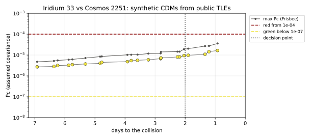
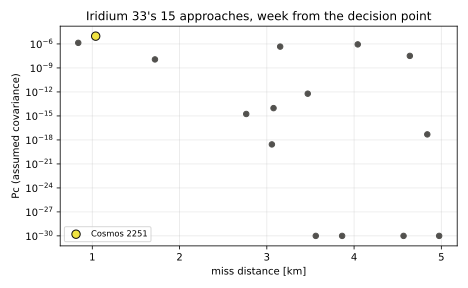
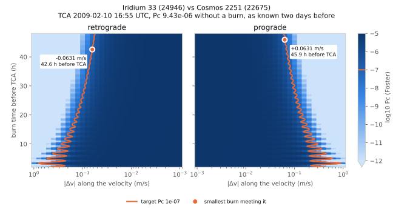

# Case study: Iridium 33 and Cosmos 2251

<!-- Generated by tools/iridium_cosmos_report.py; do not edit. -->

## Summary

On 2009 February 10, Iridium 33 (24946), an operational communications satellite, and Cosmos 2251 (22675), a long-defunct one, collided at nearly right angles over northern Russia: the first known collision of two satellites (Kelso 2009). This page runs keepout on the element sets that were public then, as an operator could have, and asks what it would have said.

- **Screening.** Each new element set of the pair in the 7 days before gives a synthetic CDM. Their miss distances run from 117 m to 1.812 km; the last, 698 m. They match what CelesTrak's SOCRATES printed from the same kind of data (117 m to 1.812 km; 584 m in its last report).
- **Pc.** On keepout's assumed covariance the Pc rose from 2.71e-06 to 1.65e-05: yellow at the decision point, never red.
- **Decision.** Two days before TCA: **monitor**.
- **Rank.** Among Iridium 33's 15 approaches in the week from the decision point, the collision was 1st by Pc and 2nd by miss distance.
- **Manoeuvre.** A prograde burn of 6.3 cm/s 46 h before TCA would have brought the Pc below 1e-07.
- **Today.** 672 catalogued fragments of the two were still in orbit on 2026-10-15; in one day they came within 5 km of other objects 1,815 times.

At the decision point keepout's default rules on the model Pc say **monitor**: the event was yellow, its Pc 9.43e-06 on the assumed covariance, and no CDM was red. Still, it was the one to watch: among Iridium 33's own 15 approaches that week it ranked 1st by Pc, 7 times the next, and its dilution maximum Pc had reached 1e-04. The rules do not call for a burn on a yellow event, and whether it stood out among the whole constellation's conjunctions keepout did not compute. Kelso found that, on the TLE data, it could not be told apart: "Determining that the predicted conjunction for Iridium 33 and Cosmos 2251 was more significant than the many dozens of other Iridium conjunctions for that week is simply not possible using the TLE data." keepout's Pc is only as good as the covariance it is given, and here the covariance is a model of GP accuracy, not of these two orbits.

## Data

Space-Track.org allows the history of an object's element sets to be queried once per account, and sends queries of many objects to its yearly bulk files. The excerpt in `tests/case_study/data/iridium-cosmos/` comes from the 2009 file (SHA-256 `e7b317ccfbe7c3d6...`, see its `manifest.json`): every element set of Iridium 33 and Cosmos 2251 from 32 days before the collision, and the newest set known at the decision point of each object that passed within 300 km of Iridium 33 from then to a week after the latest burn the planner may try. `tools/iridium_cosmos_data.py` makes it; the manifest counts what it left out: re-issued and corrected sets of the same epoch (the later kept), 2 designators without piece letters (blanked) and 4 sets keepout cannot read (a malformed B\*, 1 object). Its TLEs carry no names, so objects other than the pair are named by catalog number and international designator.

Times: the collision, 2009-02-10T16:55:59.806 UTC, is the TCA of SOCRATES's last report, which Kelso (2009) takes as the time of the collision. The decision point is two days before, 2009-02-08T16:55:59.806 UTC; an analysis at a time sees only the element sets with an epoch up to it.

## What screening saw

Each CDM is created at the epoch of the newer of the two element sets it uses (no publication latency) and screens the pair from then to an hour past the collision with SGP4. Pc is keepout's on the synthetic covariance; the maximum Pc columns bound it from above, each trusting less of that covariance: Frisbee's with Cosmos 2251's covariance unknown (Iridium 33's kept), dilution's over a scale of the combined one (its shape kept), Alfano's over any covariance.

| Created (UTC) | Known at decision point | TCA (UTC) | Miss | Pc | Max Pc (Frisbee) | Max Pc (dilution) | Max Pc (Alfano) |
|---|---|---|---|---|---|---|---|
| 2009-02-03 18:49 | yes | 16:55:59.699 | 1.585 km | 2.71e-06 | 4.73e-06 | 7.35e-06 | 1.83e-03 |
| 2009-02-04 08:13 | yes | 16:55:59.710 | 1.488 km | 2.83e-06 | 5.18e-06 | 7.87e-06 | 1.95e-03 |
| 2009-02-04 11:10 | yes | 16:55:59.741 | 1.812 km | 3.13e-06 | 5.51e-06 | 1.06e-05 | 1.60e-03 |
| 2009-02-04 19:56 | yes | 16:55:59.751 | 1.726 km | 3.25e-06 | 5.94e-06 | 1.10e-05 | 1.68e-03 |
| 2009-02-04 22:54 | yes | 16:55:59.746 | 1.676 km | 3.45e-06 | 6.17e-06 | 1.35e-05 | 1.73e-03 |
| 2009-02-05 09:20 | yes | 16:55:59.928 | 117 m | 3.72e-06 | 7.16e-06 | 1.94e-05 | 2.48e-02 |
| 2009-02-05 21:03 | yes | 16:55:59.850 | 686 m | 4.00e-06 | 8.37e-06 | 3.54e-05 | 4.23e-03 |
| 2009-02-05 22:23 | yes | 16:55:59.912 | 1.291 km | 4.44e-06 | 8.56e-06 | 5.20e-05 | 2.25e-03 |
| 2009-02-06 18:49 | yes | 16:55:59.915 | 1.243 km | 4.81e-06 | 1.02e-05 | 4.42e-05 | 2.34e-03 |
| 2009-02-06 21:53 | yes | 16:55:59.889 | 989 m | 5.41e-06 | 1.03e-05 | 5.32e-05 | 2.93e-03 |
| 2009-02-07 02:55 | yes | 16:55:59.878 | 825 m | 5.59e-06 | 1.04e-05 | 6.93e-05 | 3.52e-03 |
| 2009-02-07 11:34 | yes | 16:55:59.892 | 688 m | 5.91e-06 | 1.17e-05 | 3.60e-05 | 4.22e-03 |
| 2009-02-07 21:22 | yes | 16:55:59.870 | 574 m | 6.67e-06 | 1.20e-05 | 5.00e-05 | 5.06e-03 |
| 2009-02-07 21:37 | yes | 16:55:59.843 | 823 m | 7.26e-06 | 1.41e-05 | 8.08e-05 | 3.53e-03 |
| 2009-02-08 10:47 | yes | 16:55:59.816 | 540 m | 8.05e-06 | 1.45e-05 | 1.50e-04 | 5.37e-03 |
| 2009-02-08 12:28 | yes | 16:55:59.820 | 595 m | 8.13e-06 | 1.45e-05 | 1.51e-04 | 4.88e-03 |
| 2009-02-08 16:02 | yes | 16:55:59.773 | 1.039 km | 9.43e-06 | 1.90e-05 | 1.44e-04 | 2.79e-03 |
| 2009-02-08 19:23 | no | 16:55:59.794 | 841 m | 9.70e-06 | 2.02e-05 | 1.53e-04 | 3.45e-03 |
| 2009-02-09 08:46 | no | 16:55:59.816 | 646 m | 1.08e-05 | 2.68e-05 | 1.71e-04 | 4.49e-03 |
| 2009-02-09 11:57 | no | 16:55:59.806 | 584 m | 1.45e-05 | 2.73e-05 | 2.81e-04 | 4.97e-03 |
| 2009-02-09 18:49 | no | 16:55:59.795 | 698 m | 1.65e-05 | 3.58e-05 | 2.59e-04 | 4.16e-03 |

SOCRATES, from the same kind of data, predicted this approach in each of its 14 reports from 2009-02-04 04:01 UTC, at 16:55:59.670 to 16:55:59.990 UTC, with miss distances from 117 m to 1.812 km; its report 5 gave 117 m (2009-02-06 04:02 UTC), then 1.243 km the next day; its last report, of 2009-02-10 15:02 UTC, gave 584 m (Kelso 2009). The CDMs above give the same spread: screening on these element sets finds what SOCRATES found.

## Pc and trend

Each point is one CDM's Pc on the synthetic covariance, coloured by its risk level (green below 1e-07, red from 1e-04); the grey line is Frisbee's maximum Pc. The Pc rises as TCA nears because the model's covariance shrinks as the element sets are propagated less far, not because the miss distance falls: the misses jump between 117 m and 1.812 km.

## Decision two days before

On the 17 CDMs created by 2009-02-08 16:55 UTC, `keepout.risk.assess` with the default rules gives **monitor**: latest Pc 9.43e-06 is yellow, 2.04 d before TCA; trend steady (+0.33 decades per day). On all 21 CDMs: **monitor** (latest Pc 1.65e-05 is yellow, 0.92 d before TCA; trend steady (+0.40 decades per day)).

The combined hard-body radius is 6 m, an assumption (no dimensions are published with the data). The Pc grows about as its square:

| Combined radius | Pc at the decision point | Pc of the last CDM |
|---|---|---|
| 5 m | 6.55e-06 | 1.15e-05 |
| 6 m (base) | 9.43e-06 | 1.65e-05 |
| 10 m | 2.62e-05 | 4.58e-05 |
| 20 m | 1.05e-04 | 1.83e-04 |

## Rank among the week's approaches

Iridium 33 screened against every object as known at the decision point, for 7 days, in the default 5 km sphere, each approach with the model's covariance and the same combined hard-body radius for every secondary (so the order reflects geometry and covariance only): 15 approaches. The collision ranks 1st by Pc and 2nd by miss distance.

| Secondary | TCA (UTC) | Miss | Pc |
|---|---|---|---|
| **Cosmos 2251 (22675)** | 2009-02-10 16:55 | 1.039 km | 9.43e-06 |
| 6787 (1973-054A) | 2009-02-11 00:30 | 839 m | 1.37e-06 |
| 9823 (1976-126AK) | 2009-02-08 22:47 | 4.042 km | 8.79e-07 |
| 14240 (1983-079A) | 2009-02-11 20:28 | 3.153 km | 4.64e-07 |
| 25112 (1997-084A) | 2009-02-15 06:03 | 4.639 km | 3.21e-08 |
| 3522 (1968-092B) | 2009-02-10 01:51 | 1.718 km | 1.16e-08 |
| 30546 (1999-025AKL) | 2009-02-08 18:13 | 3.469 km | 6.03e-13 |
| 31380 (1999-025BSL) | 2009-02-13 22:50 | 3.077 km | 9.44e-15 |
| 33637 (1999-025DDW) | 2009-02-12 23:28 | 2.764 km | 1.75e-15 |
| 23433 (1994-083C) | 2009-02-10 15:06 | 4.839 km | 4.92e-18 |
| 29892 (1999-025GN) | 2009-02-10 16:13 | 3.058 km | 2.74e-19 |
| 5903 (1972-018A) | 2009-02-10 06:10 | 3.561 km | 3.19e-37 |
| 20347 (1989-080J) | 2009-02-09 16:49 | 4.567 km | 7.04e-40 |
| 32316 (1999-025CXH) | 2009-02-10 07:59 | 3.863 km | 1.66e-43 |
| 28432 (2001-049NY) | 2009-02-12 22:11 | 4.975 km | 4.85e-64 |

SOCRATES ranked conjunctions across the whole catalog and the whole Iridium constellation: the collision's overall rank went from 1,611 (report 3) to 11; 152 at the collision, and among all Iridium conjunctions from 149 (report 3) to 2 (report 5), 64 on average; Iridium 33 alone saw 10 to 15 approaches within 5 km a week out of 1,007 to 1,095 for the whole constellation (Kelso 2009). For one satellite, as here, the list is short; an operator of 66 had to sort about a thousand a week, on Pc no better than this.

## A manoeuvre

Had the operator chosen to act at the decision point, `plan_maneuver` on the CDMs known then gives the smallest along-track burns, from 48 h to 2 h before TCA, that bring the Pc (9.43e-06 without a burn) below 1e-07, green; the planner's own default, red, the event already meets. Each burn is then re-screened against the excerpt for a week (`rescreen`): the approaches it brings, and the worst Pc among them.

| Burn | Before TCA | Δv | Pc | Range at TCA | Largest shift in a week | Re-screen | Worst Pc | Conflict |
|---|---|---|---|---|---|---|---|---|
| prograde | 45.9 h | +0.0631 m/s | 9.98e-08 | 18.456 km | 114.1 km | 6 new, 1 closer | 1.06e-06 | no |
| retrograde | 42.6 h | -0.0631 m/s | 9.69e-08 | 19.112 km | 114.1 km | 5 new, 1 closer | 9.38e-07 | no |

A burn moves Iridium 33 along its orbit for the rest of the week; the excerpt holds every object that came within 300 km of it from the decision point to a week after the latest burn, and the study stops if a burn moves it more than half that radius or a re-screen runs past that time, so no object the excerpt left out can be the one a burn brings near. A demonstration of the mechanism, not advice about what Iridium should have done.

## Seventeen years later

The committed Space-Track catalog of 2026-10-15 still holds 672 catalogued fragments of the collision (104 of IRIDIUM 33, 568 of COSMOS 2251: objects of the two launches' designators catalogued after it). Screened against that catalog for one day from its retrieval, in the default 5 km sphere, they came within 5 km of other objects 1,815 times. The closest:

| Fragment | Other object | TCA (UTC) | Range |
|---|---|---|---|
| 37483 (1993-036BLL) | 39177 (COSMOS 2486) | 2026-10-16 15:46 | 173 m |
| 34064 (1993-036KB) | 39671 (COSMOS 1867 COOLANT) | 2026-10-16 10:12 | 262 m |
| 34856 (1993-036ACA) | 66751 (ICEYE-X58) | 2026-10-16 12:59 | 266 m |
| 34856 (1993-036ACA) | 57825 (STARLINK-30377) | 2026-10-16 02:38 | 276 m |
| 33832 (1993-036BZ) | 14466 (THORAD AGENA D DEB) | 2026-10-16 06:09 | 307 m |

## Assumptions

- Covariance: keepout's GP element-set age model, assumed (GP age model), not a calibrated product ([Assumptions](assumptions.md)).
- No publication latency: a CDM is created at the epoch of its newer element set.
- Corrections: of two sets of one object and epoch, the one issued later is used, even if it was issued after a CDM's creation time; the bulk file has no issue times.
- Hard-body radius: 6 m combined (4 m Iridium 33 with its arrays, 2 m Cosmos 2251), an enclosing-sphere estimate. Kelso's AAS 09-368 paper of the same title gives only their volumes (Table 1: 3.388 and 7.841 m³, a volume-equivalent combined radius of 2.2 m).
- Rank: the same combined hard-body radius for every secondary.
- Risk rules: keepout's defaults (thresholds on the conservative basis, decision point two days before TCA).

## Sources

- T.S. Kelso, "Analysis of the Iridium 33-Cosmos 2251 Collision", 10th AMOS Conference, Maui, 2009 September 2, <https://celestrak.org/publications/AMOS/2009/AMOS-2009.pdf>; also CelesTrak's page on the collision, <https://celestrak.org/events/collision/>; and the AAS 09-368 paper of the same title, 19th AAS/AIAA Astrodynamics Specialist Conference, 2009, <https://celestrak.org/publications/AAS/09-368/AAS-09-368.pdf>.
- Element sets: USSPACECOM/18 SDS via Space-Track.org, 2009 bulk TLE file and the GP catalog of 2026-10-15; basic SSA data, redistributed with this citation (see each data directory's NOTICE).
