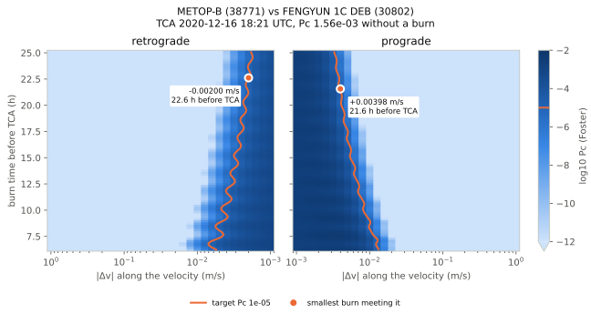

# Manoeuvre planning on a CARA test event

<!-- Generated by tools/maneuver_report.py; do not edit. -->

keepout's [manoeuvre planner](maneuver.md) on CARA test CDM `000038771_conj_000030802_20201216_182131_20201215_171306` from the [NASA CARA Analysis Tools](https://github.com/nasa/CARA_Analysis_Tools) (commit `1c78beb1f7ae`): a 2020 test conjunction of METOP-B (38771) with FENGYUN 1C DEB (30802) at 1390 m/s, red without a burn. keepout is not METOP-B (38771)'s operator, and nothing here is advice about it. Combined hard-body radius: HBR 10 m, CARA's value for this CDM (column `HBR_m` of `DataFiles/PcTestCaseCDMs/CARA_PcMethod_Test_Conjunctions.xlsx` at the same commit). The burns are along-track and impulsive, the covariances unchanged; [Assumptions and limits](maneuver.md#assumptions-and-limits) lists every assumption.

Settings: target Pc 1e-05 (keepout's default: ten times below the red threshold, 1e-04); burns from 48 h (or the CDM's creation, if later) to 6 h before TCA, 8 per orbit; Δv from 0.001 to 1 m/s, 31 per direction; green below 1e-07, red from 1e-04 (conservative basis).

## The event

|  |  |
|---|---|
| Primary (burns) | METOP-B (38771) |
| Secondary | FENGYUN 1C DEB (30802) |
| TCA (UTC) | 2020-12-16 18:21:31 |
| CDM created (UTC) | 2020-12-15 17:13:06, 25.1 h before TCA |
| Range at TCA | 147.8 m |
| Relative speed | 1390.2 m/s |
| Primary's CD·A/m | 0.025436 m²/kg |

## Pc over burn size and time

Foster's 2-D Pc after an impulsive along-track burn of the primary, by burn size (log scale; retrograde to the left) and hours before TCA, 91 burn times by 62 Δv. The CDM's covariances are used unchanged, with HBR 10 m; gravity to J6 and drag from the CDM's CD·A/m. Orange: the target 1e-05; dots: the smallest burn each way that meets it, confirmed with the event's own method.

## Minimum burns

| Burn | Before TCA | Δv | Pc | Range at TCA | Method |
|---|---|---|---|---|---|
| none | - | - | 1.56e-03 | 148 m | foster |
| retrograde | 22.6 h | -0.00200 m/s | 7.87e-06 | 624 m | foster |
| prograde | 21.6 h | +0.00398 m/s | 6.43e-06 | 793 m | foster |

Cells below the target: 2339 retrograde and 2076 prograde of 5642.

## Re-screen demonstration

!!! note "A demonstration of the mechanism, not a recommendation"
    This section shows what a re-screen does, on an event whose covariances are keepout's assumed model of GP element-set errors. Nothing here is advice about these satellites, and keepout is not their operator.

The [example synthetic operator](synthetic-operator.md) screened its fleet (`examples/synthetic-operator/fleet.toml`) against the public catalog as CelesTrak served it on 2026-10-06 (a copy kept in the repository, so the run repeats exactly), 7 days from 2026-10-06 00:00 UTC with the 5 km sphere (as in CelesTrak's SOCRATES). Its highest-Pc yellow event is planned here, with the target set to the green threshold (1e-07), and each option is re-screened against the same catalog for 7 days from the burn.

INTELSAT 39 (IS-39) (44476) and LUCH-5X (OLYMP-K 2) (55841): Pc 7.38e-06, yellow, action monitor (event `3befe6f1305d`).

|  |  |
|---|---|
| Primary (burns) | INTELSAT 39 (IS-39) (44476) |
| Secondary | LUCH-5X (OLYMP-K 2) (55841) |
| TCA (UTC) | 2026-10-08 12:03:02 |
| CDM created (UTC) | 2026-10-06 00:00:00, 60.0 h before TCA |
| Range at TCA | 3646.5 m |
| Relative speed | 2.0 m/s |
| Primary's CD·A/m | not given: drag off |

| Burn | Before TCA | Δv | Pc | Range at TCA | Method |
|---|---|---|---|---|---|
| none | - | - | 7.38e-06 | 3646 m | foster |
| retrograde | 12.1 h | -0.0398 m/s | 4.64e-08 | 9157 m | foster |
| prograde | 12.1 h | +0.0794 m/s | 6.54e-08 | 7771 m | foster |

Caveats:

- 2-D Pc assumptions questionable (a 3-D Pc may differ):
  - without a burn: the encounter lasts about 2.51e+03 s, 2.9% of the primary's orbital period (limit 1%).
  - prograde: the encounter lasts about 8.4e+03 s, 9.7% of the primary's orbital period (limit 1%).
  - retrograde: the encounter lasts about 7.17e+03 s, 8.3% of the primary's orbital period (limit 1%).
- the covariances of primary (44476) and secondary (55841) are known only in position (zero velocity block): the 3-D methods need the velocity uncertainty, so the 2-D Pc is used.
- every Pc rests on an assumed covariance (COVARIANCE_METHOD = DEFAULT).
- drag is off: the CDM gives the primary no positive CD_AREA_OVER_MASS.
- slow encounter (1.99 m/s, below 100 m/s). The planner looks for the new TCA only within 1/20 of an orbit of TCA. After a burn the pair can meet again hours away, at a Pc no cell shows: only a re-screen shows it.
- 240 of 930 cells have no Pc and are never options: 240 without a closest approach to trust, 0 where Foster's Pc failed.

### Re-screen

- **prograde** (not clean): 19879 objects screened from 2026-10-07 23:57 to 2026-10-14 23:57 UTC, 35 catalog objects left out; on the element sets (SGP4, not the CDM's orbit) the event's secondary LUCH-5X (OLYMP-K 2) (55841) has no approach within 10 minutes of the CDM's TCA; no other new or closer approach, none at red:
  - **back above the target**: the burn brings INTELSAT 39 (IS-39) and LUCH-5X (OLYMP-K 2) back together at 2026-10-09 00:07 UTC, range 4113 m, 1.9 m/s, assumed Pc 9.87e-06, yellow: above the target 1.00e-07, so this option is not clean
- **retrograde** (clean): 19879 objects screened from 2026-10-07 23:57 to 2026-10-14 23:57 UTC, 35 catalog objects left out; on the element sets (SGP4, not the CDM's orbit) the event's secondary LUCH-5X (OLYMP-K 2) (55841) has no approach within 10 minutes of the CDM's TCA; 0 new approaches and 0 closer approaches, none at red.

Only the retrograde burn is clean; `keepout maneuver` still lists the prograde one, marked not clean. The prograde burn clears the event at its TCA, but the two objects meet again hours later, above the target. The planner looks for the new TCA only near the old one (see the slow-encounter caveat above), so only the re-screen finds such a return.

A new approach is one the run without the burn does not have within 10 minutes of its TCA; a closer approach is one it has at a larger range. Their Pc is the synthetic operator's (`auto`) on its covariance model, an assumption. The re-screen searches for no other option: a burn that clears one event but brings another is for the analyst to weigh (see [Manoeuvre planning](maneuver.md#re-screen)).

## Data

CARA test CDM: NASA Conjunction Assessment Risk Analysis, [CARA Analysis Tools](https://github.com/nasa/CARA_Analysis_Tools), `DataFiles/PcTestCaseCDMs/000038771_conj_000030802_20201216_182131_20201215_171306.cdm` at commit `1c78beb1f7aefc384886c3be1d09e4681acb5d37`, distributed under the NASA Open Source Agreement and downloaded on demand; keepout publishes only numbers derived from it and the figure. GP data: USSPACECOM/18 SDS via Space-Track.org, retrieved from CelesTrak (celestrak.org) (see `tests/screening/data/NOTICE`).

## Timing

The plan of the 5642 cells took 9.9 to 11.0 s (CPU time 162.8 to 181.9 s, numerical libraries on their default threads) over 3 runs on 2026-11-03, Intel(R) Core(TM) i5-14600K (20 logical CPUs), Python 3.13.7.

<!-- tools/maneuver_report.py --check checks the numbers, not the times. -->
