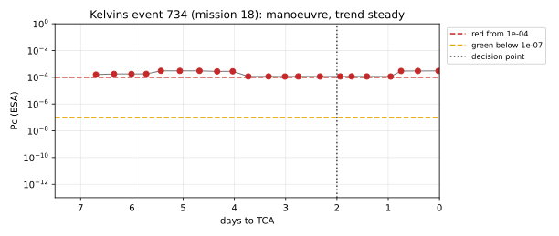
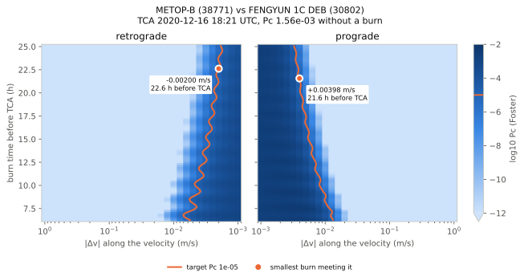
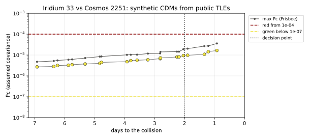

# Reports overview

The report pages run keepout on published data and show what comes out.
They are of two kinds:

- **Validations** compare keepout with an independent reference that gives
  the right answer for each case. A difference beyond the stated tolerance
  would be an error in keepout.
- **Demonstrations** run keepout where no right answer is known. They show
  how the pieces behave on real data, not whether the result is correct.

Each page is generated by a script in `tools/` from the data it names.
CI and a nightly job rerun the scripts: a validation fails when a case
fails, and the other scripts fail when the committed page no longer
matches what they produce. The results below therefore hold for the code
as it is.

## Validations

| Report | What was tested | Against what | Result | What it means |
|---|---|---|---|---|
| [Validation against NASA CARA](validation.md) | 2-D Pc (Foster, Elrod), 3-D Pc (Hall 3D-Nc) and maximum Pc (Frisbee, dilution) | NASA CARA's reference values: Alfano's test cases, real conjunctions from CARA's test CDMs and CARA's unit tests | Every comparison is within its tolerance | keepout's Pc methods compute what NASA's reference code computes, to the precision of each method |
| [Monte Carlo validation](validation-monte-carlo.md) | Monte Carlo Pc | CARA's Monte Carlo Pc on the same cases | CARA's value lies inside keepout's confidence interval on every case | keepout's sampling agrees with CARA's within sampling noise |
| [Screening against SOCRATES](screening-socrates.md) | Screening: which approaches exist, their TCA, range and relative speed | CelesTrak's SOCRATES list, computed from the same element sets | The compared approaches agree to SOCRATES's printed precision, except a few traced to element sets that differ from the ones SOCRATES used | keepout's screening finds the same approaches as an independent service |

## Demonstrations

| Report | What was tested | Against what | Result | What it means |
|---|---|---|---|---|
| [Risk on ESA's Kelvins data](risk-kelvins.md) | The decision rules: risk level, trend and decision point | ESA's own Pc in real CDM sequences, not keepout's Pc; no ground truth | A decision for every event, set against the challenge's high-risk label | How the default rules behave on real CDM sequences; not whether they decide right |
| [Synthetic operator on public data](synthetic-operator.md) | The whole chain: screening, a CDM per approach, Pc, decision | Nothing: public GP data with keepout's [synthetic covariance model](assumptions.md) | A decision for each approach of a small real fleet over a week | The pieces work together; the Pc values show what the assumed covariances imply, not the real risk |
| [Manoeuvre planning on a CARA event](maneuver-report.md) | The manoeuvre planner and the re-screen of its burns | A CARA test CDM, and an event of the synthetic operator for the re-screen | The smallest along-track burns that bring the Pc below the target; the re-screen shows when a burn brings the pair back | How the planner and the re-screen behave; not advice about these satellites |
| [Case study: Iridium 33 and Cosmos 2251](case-study-iridium-cosmos.md) | The whole chain on the element sets public before the 2009 collision: screening, synthetic CDMs, Pc and maximum Pc, decision, rank, manoeuvre and re-screen | Kelso (2009)'s account of what SOCRATES predicted from the same kind of data; no Pc reference | Screening finds the approaches SOCRATES found; the Pc on the assumed covariance stays yellow and the rules say monitor | What public data and an assumed covariance could tell an operator in 2009; not what Iridium knew or should have done |

## The results in brief

The summaries below are written by the same scripts as the pages they link
to. The validation against NASA CARA is summarised in the
[README](https://github.com/Kyrtap1309/keepout#validation) and on its
[page](validation.md#summary).

### Monte Carlo against CARA

keepout's Monte Carlo against CARA's two-body Monte Carlo
([full report](validation-monte-carlo.md), checked nightly):

<!-- validation-monte-carlo-summary:start -->
| Suite | Method | Cases passed | Worst relative error |
|---|---|---|---|
| Alfano (2009), Monte Carlo | montecarlo | 12 / 12 | 2.5e-02 |
| CARA Pc method test set, Monte Carlo | montecarlo | 21 / 21 | 9.5e-02 |
<!-- validation-monte-carlo-summary:end -->

### Screening against SOCRATES

<!-- screening-socrates-summary:start -->
Close approaches from `screen` against CelesTrak's SOCRATES, on the 1275 SOCRATES approaches computed from the same element sets ([report](screening-socrates.md)):

| Approaches | Compared | Within tolerance | Worst TCA | Worst range |
|---|---|---|---|---|
| fast (>= 1 km/s) | 266 | 261 | 0.493 ms | 0.49565 m |
| slow (< 1 km/s) | 1008 | 1008 | 324.653 ms | 0.49998 m |

5 approaches outside tolerance involve 2 objects whose element sets evidently differ from SOCRATES's. keepout also reports 5 minima of these pairs that SOCRATES does not list.
<!-- screening-socrates-summary:end -->

### Risk on ESA's Kelvins data

<!-- risk-kelvins-summary:start -->
keepout's decision for each of the 15321 events of ESA's Kelvins data, from ESA's Pc of every CDM ([report](risk-kelvins.md)):

| Decision | Events | Share |
|---|---|---|
| ignore | 13823 | 90.2% |
| monitor | 1468 | 9.6% |
| prepare maneuver | 6 | <0.1% |
| maneuver | 24 | 0.2% |

<!-- risk-kelvins-summary:end -->

Kelvins data: ESA, *Collision Avoidance Challenge dataset*, Zenodo, 2021,
[doi:10.5281/zenodo.4463683](https://doi.org/10.5281/zenodo.4463683); © ESA,
[CC BY 4.0](https://creativecommons.org/licenses/by/4.0/).

### Screening performance

The target is to screen 20 primaries against the public catalog, and
against the full catalog, for a week in under 60 s with 4 worker processes.
CI also times each change against its merge base and fails on a slowdown of
more than 20 %.

<!-- screening-benchmark-summary:start -->
Screening 20 LEO primaries against the 19914 element sets of the frozen public catalog (CelesTrak, retrieved 2026-10-06) for 7 days from 2026-10-06 00:00 UTC, with 4 worker processes (`tools/screening_benchmark.py`):

| Volume | Screened | Left out | Approaches | Wall time | CPU time |
|---|---|---|---|---|---|
| 5 km sphere (default) | 19886 | 28 stale | 715 | 8.5 s | 40.3 s |
| 10 km sphere (NASA, GP data) | 19886 | 28 stale | 2551 | 9.5 s | 44.3 s |
| SFS Handbook Table 3 | 19886 | 28 stale | 345 | 14.8 s | 65.2 s |

Times: median of 3 runs on 2026-10-07, Intel(R) Core(TM) i5-14600K (20 logical CPUs), Python 3.13.7; `--check` checks the counts, not the times.
<!-- screening-benchmark-summary:end -->

On the full catalog, which adds most of the rocket bodies and debris the
public catalog lacks (retrieved nine days later, so the week differs):

<!-- screening-benchmark-spacetrack-summary:start -->
Screening 20 LEO primaries against the 31930 element sets of the frozen full catalog (Space-Track, retrieved 2026-10-15) for 7 days from 2026-10-15 00:00 UTC, with 4 worker processes (`tools/screening_benchmark.py --source spacetrack`):

| Volume | Screened | Left out | Approaches | Wall time | CPU time |
|---|---|---|---|---|---|
| 5 km sphere (default) | 31914 | 5 future epoch, 11 propagation failed | 866 | 13.1 s | 56.1 s |
| 10 km sphere (NASA, GP data) | 31914 | 5 future epoch, 11 propagation failed | 2689 | 14.2 s | 59.3 s |
| SFS Handbook Table 3 | 31914 | 5 future epoch, 11 propagation failed | 787 | 20.1 s | 83.9 s |

Times: median of 3 runs on 2026-10-16, Intel(R) Core(TM) i5-14600K (20 logical CPUs), Python 3.13.7; `--check` checks the counts, not the times.
<!-- screening-benchmark-spacetrack-summary:end -->

### Manoeuvre planning on a CARA event

<!-- maneuver-report-summary:start -->
The burns of METOP-B (38771) that clear a red event, CARA test CDM `000038771_conj_000030802_20201216_182131_20201215_171306` (2020 test data; HBR 10 m, CARA's value; [report](maneuver-report.md)):

| Burn | Before TCA | Δv | Pc | Range at TCA | Method |
|---|---|---|---|---|---|
| none | - | - | 1.56e-03 | 148 m | foster |
| retrograde | 22.6 h | -0.00200 m/s | 7.87e-06 | 624 m | foster |
| prograde | 21.6 h | +0.00398 m/s | 6.43e-06 | 793 m | foster |

The plan of the 5642 cells took 9.9 to 11.0 s (CPU time 162.8 to 181.9 s, numerical libraries on their default threads) over 3 runs on 2026-11-03, Intel(R) Core(TM) i5-14600K (20 logical CPUs), Python 3.13.7; `--check` checks the numbers, not the times.
<!-- maneuver-report-summary:end -->

CARA test CDM: NASA CARA Analysis Tools (NASA Open Source Agreement),
downloaded on demand; only numbers derived from it and the figure are
committed.

### Case study: Iridium 33 and Cosmos 2251

<!-- iridium-cosmos-summary:start -->
keepout on the element sets public before the 2009 collision ([case study](case-study-iridium-cosmos.md)): two days before TCA the event was yellow (Pc 9.43e-06 on the assumed covariance) and the rules said **monitor**; it ranked 1st by Pc among Iridium 33's 15 approaches that week; a 6.3 cm/s burn would have made it green.

<!-- iridium-cosmos-summary:end -->
