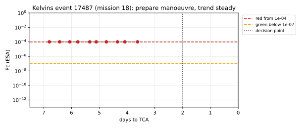

# Risk assessment on ESA's Kelvins data

<!-- Generated by tools/risk_report.py; do not edit. -->

keepout assessed every event of ESA's Collision Avoidance Challenge data set: 15321 conjunction events of ESA missions from 2015 to 2019, 199082 CDMs in all. Each CDM gives ESA's own Pc, which keepout does not recompute (the data lacks absolute states and ESA's method is not published); CDMs at ESA's floor of 1e-30 count as below it.

Settings: green below 1e-07, red from 1e-04 (conservative basis); trend over the last 3 CDMs, steady within ±0.5 decades per day; decision point 2 days before TCA. See [Risk assessment](risk.md) for the rules.

Data: ESA, *Collision Avoidance Challenge dataset*, Zenodo, 2021, doi:[10.5281/zenodo.4463683](https://doi.org/10.5281/zenodo.4463683); © ESA, [CC BY 4.0](https://creativecommons.org/licenses/by/4.0/).

## Decisions

| Decision | Events | Share |
|---|---|---|
| ignore | 13823 | 90.2% |
| monitor | 1468 | 9.6% |
| prepare maneuver | 6 | <0.1% |
| maneuver | 24 | 0.2% |

## Trend at the last CDM before TCA

| Direction | Events | Share |
|---|---|---|
| rising | 947 | 6.2% |
| steady | 11363 | 74.2% |
| falling | 2774 | 18.1% |
| undetermined | 237 | 1.5% |

## Risk at the decision point and at the last CDM

Rows: the level of the latest CDM issued at least 2 days before TCA (*none*: no CDM that early). Columns: the level of the last CDM before TCA (*none*: every CDM was issued after TCA).

| At the decision point | green | yellow | red | none |
|---|---|---|---|---|
| green | 12429 | 63 | 1 | 0 |
| yellow | 587 | 970 | 10 | 0 |
| red | 18 | 14 | 17 | 0 |
| none | 1130 | 69 | 2 | 11 |

## Against the challenge's high-risk label

The challenge called an event high-risk when its last CDM has log10 Pc >= -6. keepout decides on the CDMs issued before TCA, so an event whose only high Pc came after TCA is judged without it.

| Decision | High-risk | Not high-risk |
|---|---|---|
| ignore | 1 | 13822 |
| monitor | 484 | 984 |
| prepare maneuver | 6 | 0 |
| maneuver | 24 | 0 |

## Example events

### Red within the decision point: maneuver

### Red before the decision point: monitor and prepare a manoeuvre

### Green but rising towards yellow: monitor

### Falling to green: ignore

