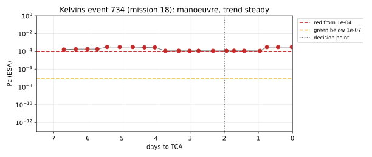
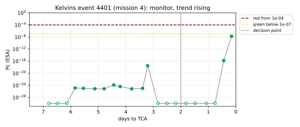
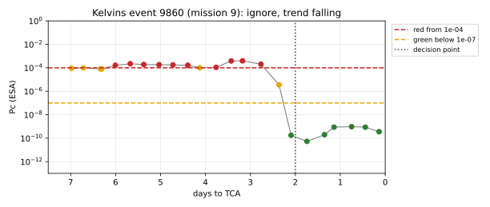

# Risk assessment on ESA's Kelvins data

<!-- Generated by tools/risk_report.py; do not edit. -->

This page runs keepout's decision rules (risk level, trend and decision point) on real sequences of CDMs. It uses ESA's Pc from each CDM, not keepout's own Pc: the data has no absolute states, and ESA's method is not published. There is no ground truth. Nobody knows which of these events would have ended in a collision, so the page shows what the rules decide, not whether they decide right.

The data is ESA's Collision Avoidance Challenge set: 15321 conjunction events of ESA missions from 2015 to 2019, 199082 CDMs in all. A CDM at ESA's floor of 1e-30 counts as a Pc below the floor.

Settings: green below 1e-07, red from 1e-04 ([conservative basis](risk.md#risk-levels)); trend over the last 3 CDMs, steady within ±0.5 decades per day; decision point 2 days before TCA. See [Risk assessment](risk.md) for the rules.

Data: ESA, *Collision Avoidance Challenge dataset*, Zenodo, 2021, doi:[10.5281/zenodo.4463683](https://doi.org/10.5281/zenodo.4463683); © ESA, [CC BY 4.0](https://creativecommons.org/licenses/by/4.0/).

## Decisions

| Decision | Events | Share |
|---|---|---|
| ignore | 13823 | 90.2% |
| monitor | 1468 | 9.6% |
| prepare maneuver | 6 | <0.1% |
| maneuver | 24 | 0.2% |

## Trend at the last CDM before TCA

| Direction | Events | Share |
|---|---|---|
| rising | 947 | 6.2% |
| steady | 11363 | 74.2% |
| falling | 2774 | 18.1% |
| undetermined | 237 | 1.5% |

## Risk at the decision point and at the last CDM

Rows: the level of the latest CDM issued at least 2 days before TCA (*none*: no CDM that early). Columns: the level of the last CDM before TCA (*none*: every CDM was issued after TCA).

| At the decision point | green | yellow | red | none |
|---|---|---|---|---|
| green | 12429 | 63 | 1 | 0 |
| yellow | 587 | 970 | 10 | 0 |
| red | 18 | 14 | 17 | 0 |
| none | 1130 | 69 | 2 | 11 |

## Against the challenge's high-risk label

The challenge called an event high-risk when its last CDM has log10 Pc >= -6. keepout decides on the CDMs issued before TCA, so an event whose only high Pc came after TCA is judged without it.

| Decision | High-risk | Not high-risk |
|---|---|---|
| ignore | 1 | 13822 |
| monitor | 484 | 984 |
| prepare maneuver | 6 | 0 |
| maneuver | 24 | 0 |

keepout ignores 1 high-risk event: its high-risk label comes from a CDM issued after TCA, which keepout does not use.

All 484 high-risk events keepout monitors are yellow at the last CDM before TCA. The challenge's line, a Pc of 1e-6, lies inside keepout's yellow band (green below 1e-07, red from 1e-04): such an event is watched for more CDMs, and a manoeuvre is considered only when its Pc reaches red.

## Example events

Each plot shows ESA's Pc of every CDM of one event against the days to TCA, coloured by level (hollow: at ESA's floor). Dashed lines: the thresholds; dotted line: the decision point.

### Red within the decision point: maneuver

The last CDM before TCA is red and at most 2 days before TCA, so keepout decides to manoeuvre.

### Red before the decision point: monitor and prepare a manoeuvre

The last CDM before TCA is red but more than 2 days before TCA: there is still time for more CDMs, so keepout monitors and prepares a manoeuvre.

### Green but rising towards yellow: monitor

The last CDM is green, but the Pc rises by more than 0.5 decades per day, so keepout monitors the event.

### Falling to green: ignore

The Pc falls and the last CDM before TCA is green, so keepout ignores the event.
